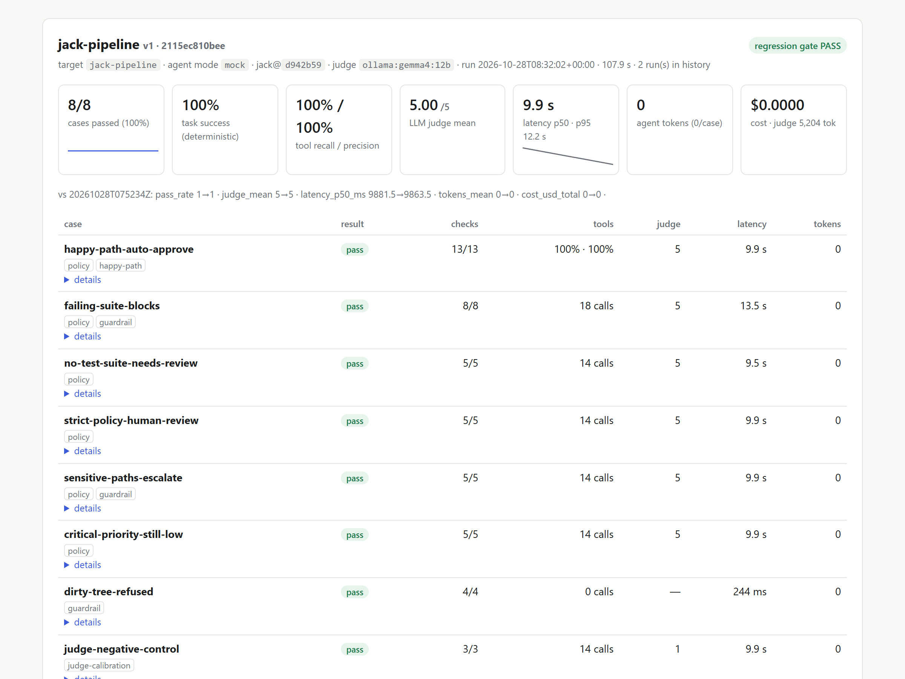

# agent-evals

**An evaluation harness for LLM agents.** Versioned golden sets, runners that drive the real agent against every case, deterministic metrics (task success, tool-call correctness, tokens and cost, latency), an LLM judge with a rubric, and a regression gate that compares each run with the previous one and fails CI when quality drops.

It is applied to two real projects:

- **[jack](https://github.com/ianfloresfdez/jack)**: a ticket → code → tests → risk → approval pipeline built on the Claude Agent SDK. Evaluated end to end through its HTTP API, with mock agents and with live agents through SmartGate.
- **[codegraph](https://github.com/ianfloresfdez/codegraph)**: code search over a tree-sitter graph and local embeddings. Its retrieval quality is measured on its own.

Both targets run unchanged. The harness starts them or calls their HTTP API and never patches their code.

**What it demonstrates:** treating agent quality like any other tested property. Golden sets are versioned data, every check is reproducible (recorded HTTP traffic, frozen clock, temperature 0), the LLM judge is itself tested with negative controls, and CI blocks a merge when a case that used to pass starts failing.

**Try it in two minutes, no GPU and no API key:** `pip install -e ".[dev]" && pytest -q` , then jack's mock pipeline suite with `--no-judge` (see [Run it](#run-it)).



```
golden/*.yaml ──▶ runner ──▶ target adapter ──▶ agent under test (jack API · codegraph API)
   (versioned,        │                                   │
    sha256 in         │◀──────────── trace ───────────────┘  output, tool calls, tokens, cost, latency, state
    every result)     ▼
              deterministic checks ──▶ LLM judge (rubric, 1-5) ──▶ results/<suite>/<run>.json
                                                                        │
                              regression gate (vs previous run or a baseline) ──▶ exit 1 in CI
                                                                        │
                                                                static HTML report
```

## Results

Measured on a Windows 11 desktop (AMD RX 6800 16 GB, Ollama on Vulkan). Everything runs locally, so the cost is $0.

| Suite | Target | Cases passed | Tool recall / precision | Judge mean (1-5) | Latency p50 / p95 | Agent tokens (total) |
|---|---|---|---|---|---|---|
| `jack-pipeline` v1 | jack API, mock agents | 8/8 | 100% / 100% | 5.00 (negative control: 1) | 9.9 s / 12.2 s | 0 (mock) |
| `codegraph-search` v1 | codegraph HTTP API, nomic-embed-text | 9/12 (recall@5) | n/a | n/a | under 1 s | 0 |

The jack mock suite's judge (`gemma4:12b`) added 5,204 tokens; the run takes about 2 minutes.

### Limits worth knowing

- **The default judge is a local 12B model.** It is free and fast, but lenient: every non-control answer got 5/5. The negative control shows it can say "wrong" (it gave 1/5 to a spec about money formatting for a dark-mode ticket). But in the jack suite it also gave 5/5 to an intake that added a criterion the ticket never asked for ("negative values keep their sign"). For real decisions, run the judge on a stronger model (`--judge openai:…` or `--judge anthropic:…`) and compare.
- **The mock suite does not measure the agents.** It validates jack's orchestration, guardrails and approval policy.
- **A handful of cases per suite is a smoke test, not a benchmark.** Expect more cases in the next version of the golden sets.

## How it works

### Golden sets

A suite is a YAML (or JSON) file under `golden/`. It names its target, default budgets, regression rules, a rubric for the judge, and the cases. The loader stores the file's SHA-256 in every result, so a run always says exactly which version of the golden set produced it, and the report flags when the set changed since the baseline.

```yaml
- id: sensitive-paths-escalate
  input:
    fixture: node-green
    project: { autoApproveUpTo: low, sensitivePaths: ["utils/", "money"] }
    ticket:
      title: Add a formatMoney helper
      description: Add formatMoney(amount, currency, locale) that formats with 2 decimals and the currency symbol.
  expect:
    fields:
      status: waiting_approval
      risk.factors: { contains: sensitive }
```

Expectations use small matchers (`equals`, `contains`, `contains_all`, `regex`, `not_regex`, `gte`, `lte`, `exists`…) on four things:

| Expectation | Checks |
|---|---|
| `output` | the agent's final answer |
| `fields` | structured state from the target, by dotted path (`risk.level`, `stages.verify`, `errors.0`) |
| `tools` | required calls and their arguments, call order, forbidden tools, maximum number of calls |
| `judge` | `min_score`, or `max_score` for a negative control that checks the judge itself |

### Metrics

| Metric | Definition |
|---|---|
| Task success | Every deterministic check of the case passed (output, fields, tools) |
| Tool recall | Required calls made with matching arguments, divided by required calls |
| Tool precision | Calls to a required or allowed tool, divided by all calls |
| Judge score | 1-5 from the LLM judge against the rubric. Negative controls are left out of the mean |
| Latency | Wall time per case, reported as p50 and p95 |
| Tokens and cost | Summed over every model call of the case. Local models cost $0; API prices are set per suite (`price_per_mtok`) |

A case **passes** when its deterministic checks, budgets and judge threshold all pass. With `--repeat N` every case runs N times. It passes only if all N attempts pass, and the run reports the share of attempts that passed and which cases are flaky (passed some attempts, failed others). Latency, tokens and judge scores are then aggregated over every attempt.

### LLM judge

The judge sees the user input, the rubric, the tools the agent called with a preview of what they returned, and the final answer. It never sees the deterministic expectations, so it grades quality and grounding rather than repeating exact matches. It answers in a JSON schema (`{reasoning, score}`) at temperature 0.

The provider is configurable: `--judge ollama:gemma4:12b` (default, local, free), `--judge openai:<model>` for OpenAI or any OpenAI-compatible server (`OPENAI_BASE_URL`), or `--judge anthropic:<model>`.

Suites include **negative controls**: cases where the right score is low. If the judge gives one a high score, the case fails, so a judge that approves everything gets caught.

### Regression gate

Every run is saved to `results/<suite>/<run_id>.json`. `--gate` compares the run with the previous run of the same suite (or with `--baseline file.json`) and exits 1 when:

- a case that passed before fails now,
- the pass rate drops,
- the judge mean drops by more than 0.5,
- p50 latency grows more than 50%, mean tokens more than 25%, or cost more than 25%. A metric that was 0 in the baseline (a mock run's tokens, a local model's cost) fails as soon as it is above 0.

Each suite can tune these thresholds in its `regression:` block, and `--skip-metric` turns one off. CI skips latency, because GitHub's runners are not the machine the baseline was measured on.

## Targets

### jack pipeline (`golden/jack/pipeline.v1.yaml`)

The adapter starts jack's API from its repo in a temporary data dir on a free port, with `JACK_AGENT_MODE=mock` set explicitly, and refuses to run if jack reports any other mode. Mock mode simulates the Claude agents, but git, the test suite, the risk scorer and the approval policy are real. So the suite checks jack's orchestration and guardrails without spending tokens.

Each case copies a fixture repo (`golden/jack/fixtures/`), commits it, registers it as a project with the case's policy, starts a run from a manual ticket and waits for a terminal state. The expected values come from jack's documented risk rules:

| Case | Setup | Expected |
|---|---|---|
| happy-path-auto-approve | green suite, threshold `low` | risk low (5) → auto-approved → shipped; the implement stage wrote `money.ts` |
| failing-suite-blocks | a failing test, baseline capture off | `tests-failed` +45 → score 50 → **blocked**, nothing shipped |
| no-test-suite-needs-review | no runnable tests | `no-tests` +20 → medium → human review |
| strict-policy-human-review | threshold `none` | low risk, still waits for a human |
| sensitive-paths-escalate | project patterns `utils/`, `money` | +20 → medium → human review |
| critical-priority-still-low | priority Highest | +5 → score 10 → still auto-approved |
| dirty-tree-refused | uncommitted change in the repo | API refuses with 409 |
| judge-negative-control | ticket about dark mode | the pipeline completes, but the judge must score ≤ 2 because the mock spec is about money formatting |

Tool calls are read from jack's run log. jack's own commands (test runs, app boot, git delivery) are filtered out so only agent calls count.

### codegraph search (`golden/codegraph/search.v1.yaml`)

Retrieval quality of codegraph's code search, which is all an agent sees of a repo before it reads
files. Eleven questions about jack's codebase (eight in English, three in Spanish), each with the file
that answers it; a case passes when that file is in the top 5 (recall@5), and the trace keeps the rank,
hit@1 and reciprocal rank. The target reindexes the repo through codegraph's HTTP API, then only
searches: no LLM generation, deterministic for a commit and an embedding model.

First run (`nomic-embed-text`, when the suite had twelve questions): **recall@5 9/12 (75%)**, hit@1
7/12, MRR 0.65. English 8/9, Spanish 1/3: the embedding model is English-first, and Spanish
questions drift to `types.ts`, which mentions everything. That is the case for a multilingual
embedding model, and this suite is how to tell whether switching helps.

## Run it

Requires Python 3.12+, Node 18.17+ for jack, and for the LLM parts [Ollama](https://ollama.com) with `gemma4:12b` pulled.

```bash
python -m venv .venv
source .venv/Scripts/activate    # Git Bash on Windows · PowerShell: .venv\Scripts\Activate.ps1 · Linux/macOS: source .venv/bin/activate
pip install -e ".[dev]"
pytest -q
```

Each suite's `target.path` says where it expects the project (relative to the YAML file); set `JACK_PATH` to point elsewhere. jack needs `npm ci`; the codegraph suite needs codegraph's UI server running (`python ui.py`).

```bash
agent-evals run golden/jack/pipeline.v1.yaml --no-judge          # mock agents, deterministic, ~2 min
agent-evals run golden/jack/pipeline.v1.yaml                     # mock agents + local judge
agent-evals run golden/jack/pipeline.v1.yaml --judge openai:gpt-4.1-mini   # another judge
agent-evals run golden/jack/pipeline.v1.yaml --gate              # exit 1 if worse than the last run
agent-evals run golden/codegraph/search.v1.yaml --no-judge       # retrieval quality, seconds
agent-evals run golden/jack/bench-shop.v1.yaml --no-judge        # live agents on SmartGate (needs SMARTGATE_JWT)
agent-evals run golden/jack/pipeline.v1.yaml --repeat 3          # 3 attempts per case, flaky cases reported
agent-evals list                                                  # run history
```

Every run is saved under `results/` and rebuilds `report/index.html` (all suites, with their history); `--no-report` skips that and `agent-evals report` rebuilds it by hand. Neither folder is committed, so a fresh clone starts with an empty report.

Only the judge and the bench-shop suite need a model; the mock jack suite and the codegraph suite need no GPU and no key.

### Adding a target

Subclass `Target` (`src/agent_evals/targets/base.py`), implement `run(case) -> Trace` and register it in `targets/__init__.py`. A trace carries the final output, the tool calls, token usage, cost, latency and any structured state the golden set wants to check.

## CI

`.github/workflows/evals.yml`:

| Job | Runs | When |
|---|---|---|
| `unit` | `pytest` | every push and PR |
| `jack-pipeline` | installs jack, runs the mock pipeline suite, gates against `baselines/jack-pipeline.json` | when `RUN_JACK_EVALS=true` and `JACK_REPO_TOKEN` can read the repo |

## Layout

```
src/agent_evals/
  schema.py       golden-set, trace and result models
  suite.py        loading, versioning (sha256), case selection
  metrics.py      matchers, task/tool/budget checks, aggregates
  judge.py        rubric judge
  llm.py          Ollama, OpenAI-compatible and Anthropic clients
  runner.py       runs a suite, stores results
  regression.py   baseline comparison and gate
  report.py       static HTML report (templates/report.html.j2)
  targets/        jack.py, codegraph.py
golden/           versioned golden sets and jack fixture repos
baselines/        reference runs used by the CI gate
tests/            unit tests
```

## License

MIT
