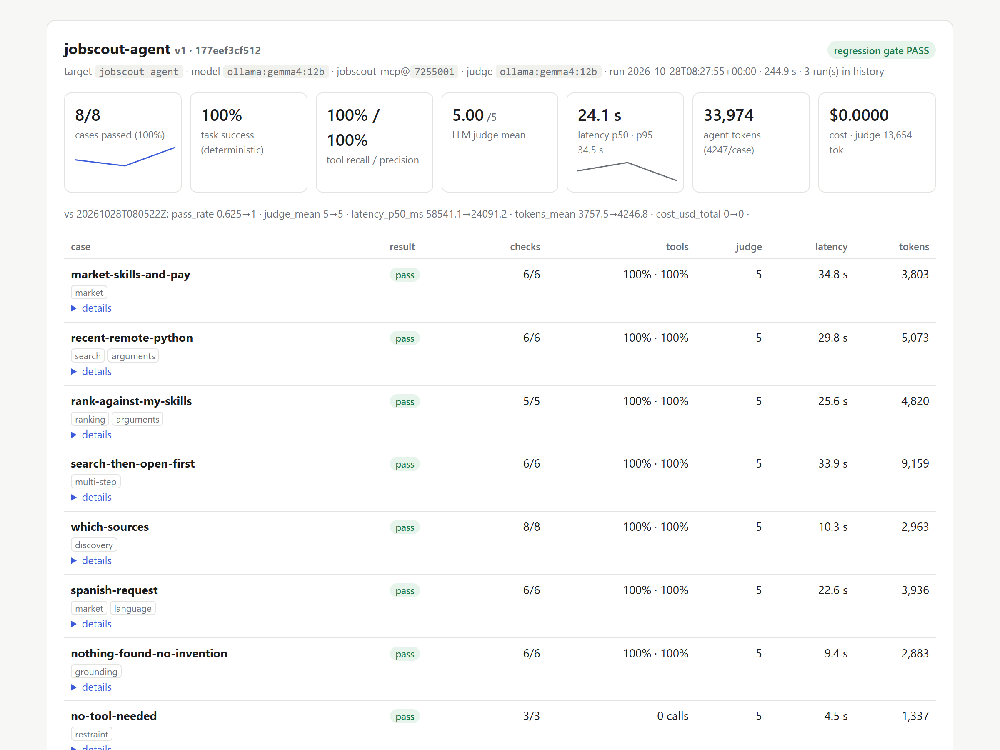
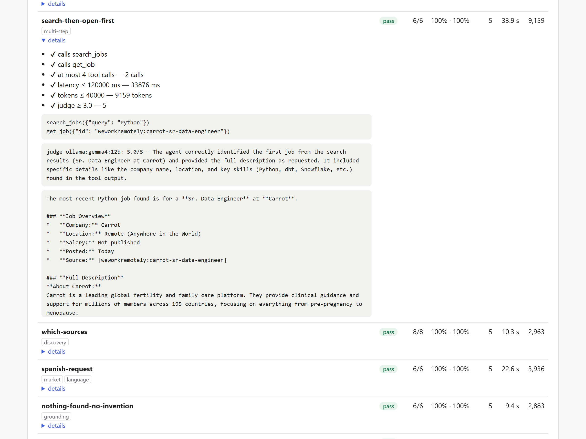

# agent-evals

**An evaluation harness for LLM agents.** Versioned golden sets, runners that drive the real agent against every case, deterministic metrics (task success, tool-call correctness, tokens and cost, latency), an LLM judge with a rubric, and a regression gate that compares each run with the previous one and fails CI when quality drops.

It is applied to two real projects:

- **[jack](https://github.com/ianfloresfdez/jack)**: a ticket → code → tests → risk → approval pipeline built on the Claude Agent SDK. Evaluated end to end through its HTTP API.
- **[jobscout-mcp](https://github.com/ianfloresfdez/jobscout-mcp)**: a TypeScript MCP server that searches job boards. Evaluated twice: its tools as an MCP contract, and a local LLM agent that uses them.

Both targets run unchanged. The harness starts them, talks to them over their public interfaces (HTTP, MCP stdio) and never patches their code.



```
golden/*.yaml ──▶ runner ──▶ target adapter ──▶ agent under test (jack API · MCP server · LLM + tools)
   (versioned,        │                                   │
    sha256 in         │◀──────────── trace ───────────────┘  output, tool calls, tokens, cost, latency, state
    every result)     ▼
              deterministic checks ──▶ LLM judge (rubric, 1-5) ──▶ results/<suite>/<run>.json
                                                                        │
                              regression gate (vs previous run or a baseline) ──▶ exit 1 in CI
                                                                        │
                                                                static HTML report
```

## Results

Measured on 28 October 2026 on a Windows 11 desktop (AMD RX 6800 16 GB, Ollama with ROCm). Agent and judge are both `gemma4:12b` running locally, so the cost is $0. jack was measured at commit `d942b59` (with uncommitted metrics work in its tree that does not touch the mock path); jobscout-mcp at `7255001`.

| Suite | Target | Cases passed | Tool recall / precision | Judge mean (1-5) | Latency p50 / p95 | Agent tokens (total) |
|---|---|---|---|---|---|---|
| `jobscout-tools` v1 | MCP tools, no LLM, replayed traffic | 8/8 | n/a | n/a | 0.6 s / 0.8 s | 0 |
| `jack-pipeline` v1 | jack API, mock agents | 8/8 | 100% / 100% | 5.00 (negative control: 1) | 9.9 s / 12.2 s | 0 (mock) |
| `jobscout-agent` v1 | gemma4:12b + jobscout MCP | 8/8 | 100% / 100% | 5.00 | 24.1 s / 34.5 s | 33,974 (≈4,250 per case) |

The judge added 13,654 tokens on the agent suite and 5,204 on the jack suite. A full jobscout-agent run takes about 4 minutes, and the jack suite about 2 minutes.

### What the runs caught

The history in `results/` (not committed) holds three runs of the agent suite. The first two did not pass, and both failures taught something:

1. **Run 1: 6/8, and the failures were in the harness.** The judge gave 2/5 to two answers and called postings from the tool output "invented". They were not: the judge only saw the first 1,500 characters of each tool result, and those postings came later in the text. Fix: the judge now sees exactly what the model saw (up to 6,000 characters per tool call), and Ollama gets a larger context window for the judge. A unit test covers it.
2. **Run 2: 5/8, and the gate failed as designed.** Another workload was using the same GPU, so one case hit the 300 s HTTP timeout and two went over the 120 s latency budget. `--gate` reported `regressed: market-skills-and-pay` and exited 1.
3. **Run 3: 8/8** on a free GPU. The gate passed and listed the three fixed cases.



### Limits worth knowing

- **The judge is the same model as the agent.** A local 12B model grading itself is free and fast, but it is lenient: every non-control answer got 5/5. The negative control shows it can say "wrong" (it gave 1/5 to a spec about money formatting for a dark-mode ticket). But in the jack suite it also gave 5/5 to an intake that added a criterion the ticket never asked for ("negative values keep their sign"). For real decisions, run the judge on a stronger model (`--judge openai:…` or `--judge anthropic:…`) and compare.
- **jack is measured in mock mode.** That validates the orchestration, guardrails and approval policy, not the quality of the Claude agents. The adapter supports `agent_mode: live`; a live run costs tokens and is not included here.
- **Eight cases per suite is a smoke test, not a benchmark.** Variance across repeated runs is not measured yet. Expect more cases, and repeats with a pass rate per case, in the next version of the golden sets.

## How it works

### Golden sets

A suite is a YAML (or JSON) file under `golden/`. It names its target, default budgets, regression rules, a rubric for the judge, and the cases. The loader stores the file's SHA-256 in every result, so a run always says exactly which version of the golden set produced it, and the report flags when the set changed since the baseline.

```yaml
- id: search-then-open-first
  input: Find recent Python jobs and open the first one with its full description.
  expect:
    tools:
      required:
        - { name: search_jobs, args: { query: { contains: python } } }
        - { name: get_job, args: { id: { regex: "^[a-z]+:.+" } } }
      ordered: true
      max_calls: 4
    judge: { min_score: 3 }
```

Expectations use small matchers (`equals`, `contains`, `contains_all`, `regex`, `not_regex`, `gte`, `lte`, `exists`…) on four things:

| Expectation | Checks |
|---|---|
| `output` | the agent's final answer |
| `fields` | structured state from the target, by dotted path (`risk.level`, `stages.verify`, `errors.0`) |
| `tools` | required calls and their arguments, call order, forbidden tools, maximum number of calls |
| `judge` | `min_score`, or `max_score` for a negative control that checks the judge itself |

### Metrics

| Metric | Definition |
|---|---|
| Task success | Every deterministic check of the case passed (output, fields, tools) |
| Tool recall | Required calls made with matching arguments, divided by required calls |
| Tool precision | Calls to a required or allowed tool, divided by all calls |
| Judge score | 1-5 from the LLM judge against the rubric. Negative controls are left out of the mean |
| Latency | Wall time per case, reported as p50 and p95 |
| Tokens and cost | Summed over every model call of the case. Local models cost $0; API prices are set per suite (`price_per_mtok`) |

A case **passes** when its deterministic checks, budgets and judge threshold all pass.

### LLM judge

The judge sees the user input, the rubric, the tools the agent called with a preview of what they returned, and the final answer. It never sees the deterministic expectations, so it grades quality and grounding rather than repeating exact matches. It answers in a JSON schema (`{reasoning, score}`) at temperature 0.

The provider is configurable: `--judge ollama:gemma4:12b` (default, local, free), `--judge openai:<model>` for OpenAI or any OpenAI-compatible server (`OPENAI_BASE_URL`), or `--judge anthropic:<model>`.

Suites include **negative controls**: cases where the right score is low. If the judge gives one a high score, the case fails, so a judge that approves everything gets caught.

### Regression gate

Every run is saved to `results/<suite>/<run_id>.json`. `--gate` compares the run with the previous run of the same suite (or with `--baseline file.json`) and exits 1 when:

- a case that passed before fails now,
- the pass rate drops,
- the judge mean drops by more than 0.5,
- p50 latency grows more than 50%, mean tokens more than 25%, or cost more than 25%.

Each suite can tune these thresholds in its `regression:` block, and `--skip-metric` turns one off. CI skips latency, because GitHub's runners are not the machine the baseline was measured on.

### Reproducible tool traffic

jobscout queries live job boards, so the same search returns different postings every day. The harness preloads a small Node module (`node --import fetch-replay.mjs`) into the unchanged MCP server. It records every HTTP response into a gzipped cassette on the first run, replays it afterwards, and freezes `Date.now()` at recording time so "posted in the last 7 days" filters give the same answer on every replay. Modes: `replay` (a miss is an error), `auto` (replay, record misses), `record`.

Cassettes are not committed: they hold third-party listings, some with contact details. CI records a fresh one. Email addresses are redacted from stored results.

## Targets

### jack pipeline (`golden/jack/pipeline.v1.yaml`)

The adapter starts jack's API from its repo in a temporary data dir on a free port, with `JACK_AGENT_MODE=mock` set explicitly, and refuses to run if jack reports any other mode. Mock mode simulates the Claude agents, but git, the test suite, the risk scorer and the approval policy are real. So the suite checks jack's orchestration and guardrails without spending tokens.

Each case copies a fixture repo (`golden/jack/fixtures/`), commits it, registers it as a project with the case's policy, starts a run from a manual ticket and waits for a terminal state. The expected values come from jack's documented risk rules:

| Case | Setup | Expected |
|---|---|---|
| happy-path-auto-approve | green suite, threshold `low` | risk low (5) → auto-approved → shipped; the implement stage wrote `money.ts` |
| failing-suite-blocks | a pre-existing failing test | `tests-failed` +45 → score 50 → **blocked**, nothing shipped |
| no-test-suite-needs-review | no runnable tests | `no-tests` +20 → medium → human review |
| strict-policy-human-review | threshold `none` | low risk, still waits for a human |
| sensitive-paths-escalate | project patterns `utils/`, `money` | +20 → medium → human review |
| critical-priority-still-low | priority Highest | +5 → score 10 → still auto-approved |
| dirty-tree-refused | uncommitted change in the repo | API refuses with 409 |
| judge-negative-control | ticket about dark mode | the pipeline completes, but the judge must score ≤ 2 because the mock spec is about money formatting |

Tool calls are read from jack's run log. jack's own commands (test runs, app boot, git delivery) are filtered out so only agent calls count.

### jobscout tools (`golden/jobscout/tools.v1.yaml`)

Contract tests for the MCP server, with no LLM: discovery, search output format, `get_job` resolving an id from a search in the same session, error results for unknown ids, schema validation rejecting an empty query, market snapshot, ranking, and unknown skills being reported. Fully deterministic with a cassette. This is the suite that gates CI.

### jobscout agent (`golden/jobscout/agent.v1.yaml`)

A tool-calling model (default `ollama:gemma4:12b`, or any `provider:model` via `AGENT_EVALS_AGENT_MODEL`) gets the server's tools, converted from their MCP JSON Schemas, and a user request. Cases cover picking the right tool, filling arguments (`max_age_days ≤ 7`, `remote_only`, the user's full skill list), a two-step search → open flow, answering in Spanish, saying "nothing found" without inventing postings, and not calling tools when none are needed.

## Run it

Requires Python 3.12+, Node 18.17+, and for the LLM parts [Ollama](https://ollama.com) with `gemma4:12b` pulled.

```bash
python -m venv .venv && .venv/Scripts/activate      # source .venv/bin/activate on Linux/macOS
pip install -e ".[dev]"
pytest -q
```

The suites expect jack and jobscout-mcp in sibling folders; otherwise set `JACK_PATH` / `JOBSCOUT_PATH`.

```bash
agent-evals run golden/jobscout/tools.v1.yaml --no-judge          # deterministic, seconds
agent-evals run golden/jack/pipeline.v1.yaml                      # mock agents + local judge
agent-evals run golden/jobscout/agent.v1.yaml                     # local LLM agent + judge
agent-evals run golden/jobscout/agent.v1.yaml --judge openai:gpt-4.1-mini   # another judge
agent-evals run golden/jack/pipeline.v1.yaml --gate               # exit 1 if worse than the last run
agent-evals report                                                 # report/index.html
agent-evals list                                                   # run history
```

The first jobscout run records the cassette: `AGENT_EVALS_CASSETTE_MODE=auto agent-evals run golden/jobscout/tools.v1.yaml --no-judge`.

### Adding a target

Subclass `Target` (`src/agent_evals/targets/base.py`), implement `run(case) -> Trace` and register it in `targets/__init__.py`. A trace carries the final output, the tool calls, token usage, cost, latency and any structured state the golden set wants to check.

## CI

`.github/workflows/evals.yml`:

| Job | Runs | When |
|---|---|---|
| `unit` | `pytest` | every push and PR |
| `jobscout-tools` | builds jobscout-mcp, runs the contract suite, gates against `baselines/jobscout-tools.json`, uploads the HTML report | every push and PR |
| `jack-pipeline` | installs jack, runs the mock pipeline suite, gates against `baselines/jack-pipeline.json` | when `RUN_JACK_EVALS=true` and `JACK_REPO_TOKEN` can read the repo |
| `jobscout-agent` | the LLM suite on a self-hosted runner with Ollama | manual dispatch |

## Layout

```
src/agent_evals/
  schema.py       golden-set, trace and result models
  suite.py        loading, versioning (sha256), case selection
  metrics.py      matchers, task/tool/budget checks, aggregates
  judge.py        rubric judge
  llm.py          Ollama, OpenAI-compatible and Anthropic clients
  runner.py       runs a suite, stores results
  regression.py   baseline comparison and gate
  report.py       static HTML report (templates/report.html.j2)
  targets/        jack.py, jobscout.py
  node/fetch-replay.mjs
golden/           versioned golden sets and jack fixture repos
baselines/        reference runs used by the CI gate
tests/            unit tests
```

## License

MIT
